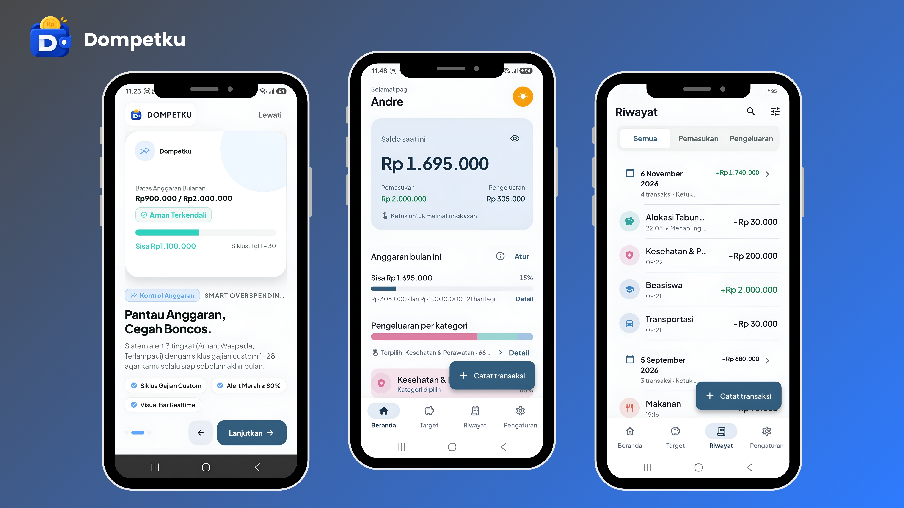

<div align="center">

# Dompetku: Catat lebih cepat. Atur lebih cerdas.

**Aplikasi pencatat keuangan pribadi berbasis Flutter dan Firebase untuk mahasiswa dan anak kos.**

[](#platform-dan-kompatibilitas)
[](https://flutter.dev/)
[](https://firebase.google.com/)
[](https://www.mediafire.com/file/xa5mu3e51gh44r1/Dompetku.apk/file)

<p><strong>Purpose:</strong> membantu mahasiswa mengelola keuangan pribadi dengan pencatatan transaksi yang cepat, pemantauan anggaran aktif, deteksi “bocor halus”, dan pembangunan target tabungan secara disiplin.</p>

</div>

<p align="center">
  
</p>
<p align="center"><sub>Cuplikan aplikasi: Onboarding, Dashboard, dan Riwayat Transaksi</sub></p>

## Daftar Isi

- [Download Dompetku](#download-dompetku)
- [Tentang Dompetku](#tentang-dompetku)
- [Fitur Utama](#fitur-utama)
- [Teknologi](#teknologi)
- [Arsitektur dan Struktur Proyek](#arsitektur-dan-struktur-proyek)
- [Prasyarat](#prasyarat)
- [Cara Menjalankan Aplikasi](#cara-menjalankan-aplikasi)
- [Konfigurasi Firebase](#konfigurasi-firebase)
- [Email Link dan Android App Links](#email-link-dan-android-app-links)
- [Export Laporan](#export-laporan)
- [Testing dan Quality Check](#testing-dan-quality-check)
- [Build dan Distribusi APK](#build-dan-distribusi-apk)
- [Keamanan dan Privasi Data](#keamanan-dan-privasi-data)
- [Roadmap](#roadmap)
- [Author](#author)
- [Lisensi](#lisensi)

## Platform dan Kompatibilitas

| Platform | Status | Catatan |
| --- | --- | --- |
| Android | Platform utama | APK release universal sudah dibangun dan dapat dipasang langsung |
| Web | Pengembangan/hosting | Cocok untuk Firebase Hosting, Google Sign-In Web, dan email action link |
| Windows | Pengembangan desktop | Build debug digunakan untuk validasi layout besar |
| iOS | Konfigurasi dasar | Validasi Google Sign-In dan deep link membutuhkan macOS/Xcode |

Package/app ID teknis tetap `com.example.savu`. Nama aplikasi yang tampil untuk pengguna adalah `Dompetku`.

## Download Dompetku

Unduh versi Android terbaru secara langsung dari MediaFire:

### [⬇️ Download Dompetku APK](https://www.mediafire.com/file/xa5mu3e51gh44r1/Dompetku.apk/file)

| Detail rilis | Nilai |
| --- | --- |
| Versi | `1.1.0+2` |
| Format | APK universal |
| Ukuran | `57.63 MB` / `60.424.977 bytes` |
| Minimum Android | Android 6.0 / API 23 |
| Package | `com.example.savu` |
| Nama aplikasi | `Dompetku` |
| SHA-256 | `3E75E493B73F798AA64CC5CC890EDC18465C1B116EBC9FAC30C87937D3D36AF0` |
| Penandatanganan | Android debug signing untuk distribusi langsung |

Cara instal dari APK:

1. Buka link download di atas.
2. Tunggu file `Dompetku.apk` selesai diunduh.
3. Buka file APK.
4. Izinkan **Install unknown apps** untuk File Manager, Chrome, atau aplikasi MediaFire bila diminta.
5. Buka aplikasi dan mulai gunakan Dompetku.

Integritas file dapat diverifikasi pada Windows PowerShell:

```powershell
Get-FileHash .\Dompetku.apk -Algorithm SHA256
```

Catatan penting:

- APK ini dimaksudkan untuk dibagikan langsung, misalnya untuk portfolio, interview, atau testing terbatas.
- APK ini **belum menjadi rilis Google Play** dan belum menggunakan release production keystore.
- Untuk publikasi resmi ke Google Play, gunakan release keystore sendiri dan daftarkan SHA-256 release ke Firebase serta Android App Links.

## Tentang Dompetku

Dompetku membantu pengguna yang sering bertanya: “uang saya habis ke mana?”. Aplikasi ini menggabungkan pencatatan transaksi, ringkasan saldo, status anggaran, target tabungan, dan ekspor laporan agar data keuangan tidak sekadar tersimpan, tetapi benar-benar mudah dipahami.

### Tujuan utama

- Mencatat pemasukan dan pengeluaran dalam hitungan detik.
- Menampilkan kondisi saldo dan anggaran secara langsung.
- Mengubah histori transaksi menjadi insight sederhana yang bisa ditindaklanjuti.
- Membantu pengguna memprioritaskan dana untuk target seperti UKT, gadget, atau dana darurat.
- Menjaga data setiap pengguna tetap terisolasi dan tidak tercampur.

### Alur penggunaan utama

1. Pengguna masuk melalui email, Google, email link, atau mode guest.
2. Pengguna melihat saldo dan kondisi anggaran di Dashboard.
3. Pengguna menambahkan transaksi melalui Quick Add.
4. Data tersimpan ke Firestore di ruang milik pengguna tersebut.
5. Dashboard memperbarui ringkasan, chart, dan insight secara real-time.
6. Pengguna mengalokasikan saldo ke target tabungan secara atomik.
7. Pengguna dapat mengekspor laporan ke Excel atau data transaksi ke CSV.

## Fitur Utama

| Fitur | Ringkasan |
| --- | --- |
| Autentikasi | Email/password, verifikasi email, email link, Google Sign-In Android/Web, guest, reset password, dan account linking |
| Quick Add | Bottom sheet cepat, format nominal Rupiah, pilihan kategori umum dan custom, tanggal transaksi, catatan opsional |
| Dashboard | Saldo berbasis siklus anggaran aktif, pemasukan/pengeluaran, chart kategori, dan empty state yang informatif |
| Budget Guard | Siklus custom 1–28, status Aman/Waspada/Terlampaui, peringatan visual mulai 80% penggunaan anggaran |
| Riwayat | Pengelompokan harian, pencarian, filter kategori, tipe transaksi, siklus anggaran, edit/hapus transaksi, summary harian |
| Target Tabungan | Target bertahap dengan deadline, progress visual, alokasi atomik, edit/tarik alokasi, status aktif/selesai/diarsipkan |
| Export Laporan | Laporan Excel 5 sheet dan CSV Data; termasuk `Ringkasan`, `Transaksi`, `Per Kategori`, `Bulanan`, dan `Target Tabungan` |
| Privacy Mode | Menyamarkan nominal pada Dashboard tanpa mengubah data asli |
| Onboarding | Tiga slide pengenalan dan tampil satu kali untuk pengguna baru |
| Profil | Nama, tipe profil, 30 avatar preset, avatar picker langsung, dan status sinkronisasi |
| Help Center | FAQ interaktif, status sinkronisasi, retry, dan kontak founder |
| Keamanan | Firebase Authentication, Firestore per-user scope, batch atomik untuk alokasi, dan Firestore Rules |

## Teknologi

| Komponen | Teknologi | Peran |
| --- | --- | --- |
| Framework | Flutter 3.32+ | Membangun Android, Web, Windows, dan iOS dari satu codebase |
| Bahasa | Dart 3.8+ | Bahasa utama UI, Domain, dan Data layer |
| State Management | Riverpod 3 | Notifier, AsyncNotifier, provider, dan dependency injection |
| Authentication | Firebase Authentication | Email/password, email link, Google Sign-In, Anonymous/Guest |
| Database | Cloud Firestore | Data transaksi dan target tabungan real-time per pengguna |
| Hosting | Firebase Hosting | Web build dan Android App Links untuk email link |
| Chart | fl_chart 1.0.0 | Donut chart kategori pengeluaran |
| Export XLSX | excel_community 1.0.10 | Membuat laporan Excel 5 sheet |
| Zip/XML | archive 4.2.0 | Menambahkan freeze pane dan filter otomatis pada worksheet Transaksi |
| Sharing | share_plus | Share laporan Excel dan CSV melalui system share sheet |
| Deep Link | app_links | Membuka email link langsung di aplikasi Android |
| Testing | flutter_test | Unit test dan widget test |

Project ini memakai **Riverpod**, bukan Provider/BLoC. Domain logic disimpan dalam use case Dart murni agar mudah diuji tanpa Flutter binding.

## Arsitektur dan Struktur Proyek

Dompetku menerapkan **Clean Architecture** agar UI, aturan bisnis, dan akses data tidak tercampur.

```text
savu/
├── android/                         # Konfigurasi dan resource Android
├── ios/                             # Konfigurasi dan resource iOS
├── linux/                           # Konfigurasi desktop Linux
├── macos/                           # Konfigurasi desktop macOS
├── web/                             # Entry point web dan assetlinks.json
├── windows/                         # Konfigurasi desktop Windows
├── assets/
│   ├── fonts/                       # Plus Jakarta Sans
│   └── images/                      # Logo dan aset gambar aplikasi
├── docs/                            # Dokumentasi export dan setup Firebase
├── lib/
│   ├── main.dart                    # Bootstrap Firebase, Riverpod, dan AuthGate
│   ├── firebase_options.dart        # Konfigurasi Firebase hasil FlutterFire
│   ├── core/                        # Infrastruktur lintas fitur
│   │   ├── firebase/                # Auth provider dan Firebase bootstrap
│   │   ├── local_storage/            # SharedPreferences dan settings provider
│   │   ├── navigation/               # App shell dan NavigationBar
│   │   ├── theme/                    # Design tokens dan ThemeData
│   │   └── utils/                    # Formatter tanggal dan nominal
│   └── features/
│       ├── analytics/               # Module analitik; belum diekspos ke navigation utama
│       ├── auth/                    # Login, Google, email link, dan verification
│       ├── dashboard/               # Saldo, budget, chart, dan insight
│       ├── export/                  # Laporan Excel dan CSV Data
│       ├── onboarding/              # Pengantar aplikasi untuk pengguna baru
│       ├── savings/                 # Target tabungan dan alokasi
│       ├── settings/                # Pengaturan dan manajemen data
│       └── transactions/            # Quick Add, History, filter, dan transaksi
└── test/                            # Unit test dan widget test
```

### Pola layer pada setiap fitur

```text
feature/
├── domain/
│   ├── entities/                    # Objek bisnis murni
│   ├── repositories/                # Kontrak repository
│   └── usecases/                    # Aturan bisnis dan kalkulasi
├── data/
│   ├── models/                      # Konversi entity ke/dari Firestore
│   ├── repositories/                # Implementasi repository
│   ├── providers/                    # Dependency injection data layer
│   └── exporters/                    # Exporter CSV/XLSX untuk fitur export
└── presentation/
    ├── pages/                       # Halaman utama
    ├── providers/                    # Notifier dan state UI
    └── widgets/                     # Komponen UI yang reusable
```

Prinsip utamanya:

- **Domain** tidak bergantung pada Flutter UI atau Firebase.
- **Data** menerjemahkan dokumen Firestore menjadi entity Domain.
- **Presentation** menampilkan state dan meneruskan aksi pengguna ke controller/use case.
- Use case dapat diuji tanpa koneksi Firebase.

## Prasyarat

- Flutter SDK 3.32 atau lebih baru.
- Dart SDK 3.8 atau lebih baru.
- VS Code atau Android Studio dengan extension Flutter.
- Android SDK dan minimal satu emulator/perangkat Android.
- Firebase project aktif.
- Firebase CLI dan FlutterFire CLI bila ingin mengubah konfigurasi Firebase.

## Cara Menjalankan Aplikasi

### 1. Clone repository

```bash
git clone <URL_REPOSITORY>
cd savu
```

`savu` adalah nama folder/package teknis. Nama aplikasi yang tampil ke pengguna tetap `Dompetku`.

### 2. Periksa environment

```bash
flutter doctor
```

Pastikan Flutter SDK, Android toolchain, dan device sudah terdeteksi.

### 3. Pasang dependency

```bash
flutter pub get
```

### 4. Jalankan di perangkat

```bash
flutter run
```

Untuk memilih device tertentu:

```bash
flutter devices
flutter run -d <device_id>
```

## Konfigurasi Firebase

### Project Firebase

Project ini menggunakan Firebase project:

```text
money-tracker-e22c0
```

### Android

- File `android/app/google-services.json` diperlukan.
- Package name: `com.example.savu`.
- Tambahkan SHA-1 dan SHA-256 debug/release ke Firebase Console.
- Aktifkan provider Anonymous, Email/Password, Google, dan Email Link sesuai kebutuhan.
- Pastikan setiap build yang didistribusikan memakai signing certificate yang sama.

### Web

- Tambahkan domain Hosting ke **Authorized domains** pada Firebase Authentication.
- Domain yang dipakai untuk action link: `money-tracker-e22c0.web.app`.
- Firebase Hosting membaca output dari folder `build/web`.

### Firestore

- Struktur baru menggunakan path `users/{uid}/transactions`.
- Target tabungan menggunakan path `users/{uid}/savings_goals`.
- Firestore Rules membatasi akses berdasarkan `request.auth.uid`.
- Deploy rules sebelum digunakan lebih luas.

Contoh deploy:

```bash
flutter build web
firebase deploy --only hosting,firestore:rules
```

## Email Link dan Android App Links

Email link dirancang agar tautan dari Gmail dapat membuka langsung aplikasi Android, bukan sekadar browser.

Alurnya:

1. Pengguna memilih mode Email Link.
2. Firebase mengirim action link ke email pengguna.
3. Host `money-tracker-e22c0.web.app` dikenali melalui intent-filter Android.
4. `app_links` meneruskan URL ke Flutter saat aplikasi terbuka atau baru dimulai.
5. `AuthController` memproses link dan membuat sesi login.
6. Jika App Links belum aktif, pengguna tetap dapat menyalin/menempel link ke fallback form.

File dan bagian penting:

- `android/app/src/main/AndroidManifest.xml`
- `web/.well-known/assetlinks.json`
- `lib/main.dart`
- `lib/core/firebase/auth_providers.dart`

Untuk distribusi production, tambahkan SHA-256 release keystore ke `assetlinks.json`, deploy Hosting, lalu uji langsung dari Gmail pada perangkat Android.

## Export Laporan

Dompetku mendukung dua format ekspor:

| Format | Isi |
| --- | --- |
| Laporan Excel | 5 sheet: Ringkasan, Transaksi, Per Kategori, Bulanan, Target Tabungan |
| CSV Data | Satu tabel datar untuk Excel, Google Sheets, atau Python |

Dokumen format lengkap tersedia di [`docs/export-format.md`](docs/export-format.md).

Poin penting:

- CSV memakai encoding UTF-8 dengan BOM dan CRLF.
- Pemisah CSV default adalah `;`; opsi `,` tersedia di aplikasi.
- Nominal ekspor memakai rupiah bulat.
- Alokasi tabungan tidak dicampur dengan pengeluaran; ditampilkan sebagai `Ditabung`.
- Laporan menampilkan dua saldo: `Saldo akhir periode` dan `Saldo siklus aktif (dashboard)`.

## Testing dan Quality Check

Static analysis:

```bash
flutter analyze
```

Test suite:

```bash
flutter test
```

Status terakhir pada 2026-11-09:

```text
flutter analyze → No issues found
flutter test    → 191/191 All tests passed
```

Test mencakup use case budget, filter transaksi, alokasi tabungan, insight, formatter, export, transfer, widget utama, dan regressi UI penting.

## Build dan Distribusi APK

### Build Android Debug

```bash
flutter build apk --debug
```

### Build Android Release

```bash
flutter build apk --release
```

Output:

```text
build/app/outputs/flutter-apk/app-release.apk
```

Untuk build yang dibagikan saat ini:

```text
Version  : 1.1.0+2
Size     : 57.63 MB
SHA-256  : 3E75E493B73F798AA64CC5CC890EDC18465C1B116EBC9FAC30C87937D3D36AF0
```

### Catatan distribusi

- Distribusi ini memakai Android debug signing.
- Untuk Google Play, buat release keystore, simpan secara privat, dan jangan commit keystore.
- Setelah membuat release keystore, daftarkan SHA-256 release ke Firebase dan `assetlinks.json`.

## Keamanan dan Privasi Data

- Setiap transaksi berada dalam path `users/{uid}/transactions`.
- Target tabungan berada dalam path `users/{uid}/savings_goals`.
- Firestore Rules hanya mengizinkan pemilik data untuk membaca/menulis data miliknya.
- Password diproses Firebase Authentication; password tidak disimpan di Firestore.
- Alokasi tabungan menggunakan batch/transaksi atomik agar saldo dan target tidak menjadi tidak konsisten.
- Penghapusan target dengan banyak riwayat memakai batch berukuran aman.
- Privacy Mode hanya menyamarkan nominal tampilan dan tidak mengubah data.
- Export data hanya membuat file saat pengguna memilih tombol Bagikan/Export.

## Roadmap

- Dashboard saldo dan insight keuangan.
- Quick Add pemasukan dan pengeluaran.
- Budget guard dan overspending alert.
- Target tabungan dengan alokasi atomik.
- History dengan edit, hapus, search, dan filter.
- Settings dan Privacy Mode.
- Firebase Authentication dan user-scoped Firestore.
- Email verification dan email link flow.
- Android App Links untuk email link.
- Rebrand aplikasi menjadi Dompetku.
- Onboarding dan katalog avatar profil.
- Export Laporan Excel 5 sheet dan CSV v2.
- Redesign profile header dan auth value proposition.
- APK release universal untuk distribusi langsung.
- Wiring halaman analytics ke navigation, setelah desain final diputuskan.
- Release keystore dan rilis Google Play.
- Validasi iOS dan Google Sign-In pada macOS/Xcode.
- Migrasi data lama bila masih ada collection global yang dipakai.
- CI untuk menjalankan `flutter analyze` dan `flutter test` otomatis.
- Upgrade Flutter/Dart untuk mengevaluasi XLSX dependency yang lebih baru.

## Author

- **Author:** Andre Robert
- **Product:** Dompetku

## Lisensi

Lisensi belum ditentukan. Gunakan kode dan aset proyek ini hanya dengan izin pemilik proyek.
